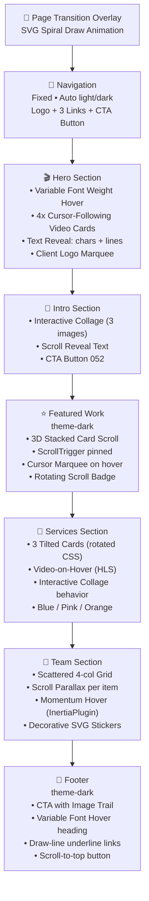

# Extrafazant.nl — Complete Design System & Recreation Guide

> **Source**: [extrafazant.nl](https://www.extrafazant.nl/)
> **Designer/Developer**: Dylan Brouwer ([dylanbrouwer.design](https://dylanbrouwer.design/))
> **Awards**: Awwwards Site of the Day (SOTD) + Developer Award (Nov 2026)
> **Platform**: Webflow + Custom Code (Odyn bundle)
> **CMS**: Contentful

---

## Table of Contents

1. [Tech Stack & Dependencies](#1-tech-stack--dependencies)
2. [Color System & Theming](#2-color-system--theming)
3. [Typography System](#3-typography-system)
4. [Layout & Spacing System](#4-layout--spacing-system)
5. [Page Structure & Sections](#5-page-structure--sections)
6. [Navigation System](#6-navigation-system)
7. [Page Transitions (Barba.js)](#7-page-transitions-barbajs)
8. [Smooth Scrolling (Lenis)](#8-smooth-scrolling-lenis)
9. [Text Reveal Animations](#9-text-reveal-animations)
10. [Scroll Reveal Animations](#10-scroll-reveal-animations)
11. [Variable Font Mouse Interaction](#11-variable-font-mouse-interaction)
12. [SVG Draw Line Underlines](#12-svg-draw-line-underlines)
13. [Cursor Marquee System](#13-cursor-marquee-system)
14. [Hero Cursor Cards (Video Follows Mouse)](#14-hero-cursor-cards-video-follows-mouse)
15. [Featured Work — Stacked Card Scroll](#15-featured-work--stacked-card-scroll)
16. [Interactive Collage (Hover Layout Shift)](#16-interactive-collage-hover-layout-shift)
17. [Services Cards (Video on Hover)](#17-services-cards-video-on-hover)
18. [Client Logo Marquee](#18-client-logo-marquee)
19. [Team Grid with Parallax & Momentum Hover](#19-team-grid-with-parallax--momentum-hover)
20. [Footer CTA — Image Trail Effect](#20-footer-cta--image-trail-effect)
21. [Button Components](#21-button-components)
22. [Scroll-to-Top Button](#22-scroll-to-top-button)
23. [Responsive Breakpoints](#23-responsive-breakpoints)
24. [Performance & Optimization](#24-performance--optimization)
25. [Full Page Map](#25-full-page-map)

---

## 1. Tech Stack & Dependencies

### Core Libraries (load order)

| Library | Version | CDN URL | Purpose |
|---------|---------|---------|---------|
| jQuery | 3.5.1 | `d3e54v103j8qbb.cloudfront.net` | Webflow dependency |
| GSAP | 3.15.0 | `cdn.prod.website-files.com/gsap/` | Core animation engine |
| GSAP CustomEase | 3.15.0 | same | Custom easing curves |
| GSAP SplitText | 3.15.0 | same | Character/word/line splitting |
| GSAP DrawSVGPlugin | 3.15.0 | same | SVG path drawing animations |
| GSAP ScrollTrigger | 3.15.0 | same | Scroll-linked animations |
| GSAP InertiaPlugin | 3.15.0 | same | Physics-based momentum |
| Barba.js | 2.10.3 | `cdn.jsdelivr.net` | SPA-like page transitions |
| Lenis | 1.3.17 | `cdn.jsdelivr.net` | Smooth scroll engine |
| HLS.js | 1.6.11 | `cdn.jsdelivr.net` | HLS video streaming |
| Odyn Bundle | — | `cdn.odyn.dev/auto/g6yf/bundle.js` | Custom animation orchestrator |

### GSAP Plugin Registration

```javascript
gsap.registerPlugin(CustomEase, SplitText, DrawSVGPlugin, ScrollTrigger, InertiaPlugin);
```

### Webflow Architecture
- Uses `data-barba="wrapper"` on `<body>` and `data-barba="container"` on `<main>`
- Page transitions with Barba.js `sync: true` mode
- `preventRunning: true` prevents overlapping transitions
- `timeout: 7000` — 7s timeout for page loads
- Links use `<link rel="prefetch">` for all internal routes

---

## 2. Color System & Theming

### Core Swatches

| Token | Hex | Usage |
|-------|-----|-------|
| `--_colors---swatch--black` | `#101010` | Primary dark / headings |
| `--_colors---swatch--off-white` | `#f4f4f4` | Primary light / backgrounds |
| `--_colors---swatch--white` | `#ffffff` | Pure white |
| `--_colors---swatch--blue` | `#0038ff` | Primary accent / buttons / brand |
| `--_colors---swatch--pink` | `#ff77cd` | Secondary accent / brand |
| `--_colors---swatch--orange` | `#ff5f04` | Tertiary accent / brand |
| Eerie Black | `#171c1c` | Dark heading variant |
| Anti-flash White | `#eef0f2` | Light background variant |
| Ash Grey | (via variable) | Button bg / muted text |

### Theme Modes

The site uses CSS class-based theming via `.theme-dark`, `.theme-blue`, `.theme-orange`, `.theme-pink`:

#### Default (Light) Theme
```css
--_theme---background: var(--_colors---swatch--off-white);   /* #f4f4f4 */
--_theme---body-text: var(--_colors---swatch--black);         /* #101010 */
--_theme---heading: var(--_colors---swatch--black);           /* #101010 */
--_theme---button-bg: var(--_colors---swatch--blue);          /* #0038ff */
--_theme---button-text: var(--_colors---swatch--white);       /* #ffffff */
--_theme---border: var(--_colors---swatch--black);            /* #101010 */
--_theme---cursor-select-bg: var(--_colors---swatch--blue);
--_theme---cursor-select-text: var(--_colors---swatch--white);
```

#### Dark Theme (`.theme-dark`)
```css
--_theme---background: var(--_colors---swatch--black);        /* #101010 */
--_theme---body-text: var(--_colors---swatch--off-white);     /* #f4f4f4 */
--_theme---heading: var(--_colors---swatch--off-white);
--_theme---button-bg: var(--_colors---swatch--pink);          /* #ff77cd */
--_theme---button-text: var(--_colors---swatch--black);
--_theme---border: var(--_colors---swatch--off-white);
--_theme---cursor-select-bg: var(--_colors---swatch--pink);
--_theme---cursor-select-text: var(--_colors---swatch--black);
```

#### Blue Theme (`.theme-blue`)
```css
--_theme---background: var(--_colors---swatch--blue);         /* #0038ff */
--_theme---body-text: var(--_colors---swatch--off-white);
--_theme---button-bg: var(--_colors---swatch--off-white);
--_theme---button-text: var(--_colors---swatch--black);
```

#### Orange Theme (`.theme-orange`)
```css
--_theme---background: var(--_colors---swatch--orange);       /* #ff5f04 */
/* Same pattern as blue — light text on colored background */
```

#### Pink Theme (`.theme-pink`)
```css
--_theme---background: var(--_colors---swatch--pink);         /* #ff77cd */
/* Same pattern — light text on colored background */
```

### Nav Theme Auto-Switch
The navigation dynamically switches between light and dark themes based on which section is in view, using `data-nav-theme="dark"` attributes on sections:

```javascript
ScrollTrigger.create({
  trigger: section,
  start: `top ${navHeight}px`,
  end: `bottom ${navHeight}px`,
  onToggle: (self) => {
    if (self.isActive) nav.dataset.navThemeActive = "dark";
    else delete nav.dataset.navThemeActive;
  }
});
```

---

## 3. Typography System

### Font Families

| Token | Font | Fallback | Usage |
|-------|------|----------|-------|
| `--_fonts---fonts--heading` | "Helvetica Now Subset" | Arial, sans-serif | All headings |
| `--_fonts---fonts--alt-heading` | "Serrif Subset" | Arial, sans-serif | `.heading-alt` italic/decorative |
| `--_fonts---fonts--paragraph` | "Helvetica Now Subset" | Arial, sans-serif | Body text |
| (system loaded) | Inter | — | Loaded via Google Fonts: 300-700 |

### Font Weights

| Token | Weight |
|-------|--------|
| `--thin` | 100 |
| `--extra-light` | 200 |
| `--light` | 300 |
| `--normal` | 400 |
| `--medium` | 500 |
| `--semi-bold` | 600 |
| `--bold` | 700 |
| `--extra-bold` | 800 |
| `--black` | 900 |

### Heading Scale

| Class | Size Token | Resolved (Desktop) | Line Height | Weight | Letter Spacing |
|-------|-----------|---------------------|-------------|--------|----------------|
| `.heading-xxl` | `--size--192px` | 12em (192px) | 0.8em | 700 (bold) | -0.02em |
| `.heading-xl` | `--size--128px` | 8em (128px) | 0.8em | 700 (bold) | -0.02em |
| `.heading-l` | `--size--96px` | 6em (96px) | 0.8em | 500 (medium) | -0.02em |
| `.heading-m` | `--size--80px` | 5em (80px) | 0.8em | 700 (bold) | -0.02em |
| `.heading-s` | `--size--64px` | 4em (64px) | 0.9em | 700 (bold) | -0.02em |
| `.heading-xs` | `--size--40px` | 2.5em (40px) | 0.9em | 700 (bold) | -0.02em |
| `.heading-xxs` | `--size--24px` | 1.5em (24px) | 0.9em | 700 (bold) | -0.02em |

### `.heading-alt` (Decorative Variant)
```css
.heading-alt {
  font-family: var(--_fonts---fonts--alt-heading); /* "Serrif Subset" */
  font-style: italic;
  /* Typically lighter weight: 300 at rest, 800 near cursor */
}
```

### Paragraph Scale

| Class | Size | Line Height | Weight | Letter Spacing |
|-------|------|-------------|--------|----------------|
| `.paragraph-xl` | 2.5em | 1.3em | 500 | -0.04em |
| `.paragraph-l` | 1.5em | 1.4em | 500 | -0.04em |
| `.paragraph-m` | 1.25em | 1.4em | 500 | -0.04em |
| `.paragraph-regular` | 1em | 1.4em | 500 | -0.04em |
| `.paragraph-s` | 0.875em | 1.3em | 500 | -0.03em |
| `.paragraph-xs` | 0.75em | 1.3em | 500 | -0.03em |
| `.paragraph-xxs` | 0.625em | 1.4em | 500 | -0.045em |

### Eyebrow Labels

| Class | Usage |
|-------|-------|
| `.eyebrow-l` | Hero subtitle (large) |
| `.eyebrow-m` | Section labels (medium) |
| `.eyebrow-s` | Card subtitles, smaller labels |

---

## 4. Layout & Spacing System

### Grid System
```css
--_layout---padding-global--page-padding: 2em;
--_layout---grid--gap: 2em;
```

- Container: `.container-col-12` — max-width: 940px (Webflow default)
- Global padding wrapper: `.padding-global` — applies horizontal padding
- Section padding: `.section-padding-128px` — vertical padding

### Size Scale (Desktop)

| Token | Em Value | Pixel Equiv |
|-------|----------|-------------|
| `--size--2px` | 0.125em | 2px |
| `--size--4px` | 0.25em | 4px |
| `--size--8px` | 0.5em | 8px |
| `--size--12px` | 0.75em | 12px |
| `--size--16px` | 1em | 16px |
| `--size--24px` | 1.5em | 24px |
| `--size--32px` | 2em | 32px |
| `--size--40px` | 2.5em | 40px |
| `--size--48px` | 3em | 48px |
| `--size--56px` | 3.5em | 56px |
| `--size--64px` | 4em | 64px |
| `--size--72px` | 4.5em | 72px |
| `--size--80px` | 5em | 80px |
| `--size--88px` | 5.5em | 88px |
| `--size--96px` | 6em | 96px |
| `--size--104px` | 6.5em | 104px |
| `--size--112px` | 7em | 112px |
| `--size--128px` | 8em | 128px |
| `--size--160px` | 10em | 160px |
| `--size--192px` | 12em | 192px |
| `--size--224px` | 14em | 224px |
| `--size--256px` | 16em | 256px |
| `--size--320px` | 20em | 320px |

---

## 5. Page Structure & Sections

### Site Map (All Pages)

| Route | Type |
|-------|------|
| `/` | Homepage |
| `/over` | About page |
| `/werk` | Work/portfolio index |
| `/werk/[slug]` | Individual case studies (e.g., `/werk/odido`, `/werk/willem-ii`, `/werk/p-van-der-niet`) |
| `/wat-we-doen` | Services page |
| `/contact` | Contact page |
| `/faq` | FAQ page |
| `/privacyverklaring` | Privacy policy |
| `/algemene-voorwaarden` | Terms & conditions |

### Homepage Section Order

```
<body data-barba="wrapper">
  <div class="page-wrapper">
    <!-- Cookie consent (CookieFlow by Reform Digital) -->
    <!-- Global styles & overrides (embedded) -->
    <!-- Transition overlay (SVG spiral shape) -->
    <!-- Cursor marquee (global) -->
    
    <main data-barba="container" class="main-wrapper">
      <nav class="nav w-nav">              <!-- Fixed navigation -->
      
      <header class="section_hero">         <!-- Hero: variable font + cursor video cards -->
        <!-- Client logos marquee -->
      </header>
      
      <section class="section_intro">       <!-- Intro: interactive collage + text -->
      
      <section class="section_featured      <!-- Featured work: stacked card scroll -->
               theme-dark"
               data-nav-theme="dark">
      
      <section class="section_services">    <!-- Services: tilted interactive cards -->
      
      <section class="section_team">        <!-- Team: scattered grid + parallax -->
      
      <footer class="footer theme-dark"     <!-- Footer: CTA + image trail + nav -->
              data-nav-theme="dark">
    </main>
  </div>
</body>
```

---

## 6. Navigation System

### Structure
```html
<div data-nav="" class="nav w-nav">
  <div class="nav-inner">
    <!-- SVG Logo (custom "extrafazant" script lettering) -->
    <a class="nav-logo">...</a>
    
    <!-- Nav background (for mobile menu) -->
    <div data-nav-bg="" class="nav-menu-bg"></div>
    
    <!-- Links -->
    <div data-nav-menu="" class="nav-links">
      <a href="/over" data-draw-line-persist data-draw-line class="nav-link">Over</a>
      <a href="/werk" data-draw-line-persist data-draw-line class="nav-link">Werk</a>
      <a href="/wat-we-doen" data-draw-line-persist data-draw-line class="nav-link">Wat we doen</a>
    </div>
    
    <!-- Contact CTA button (button-093 component) -->
    <a href="/contact" class="button-093">Contact</a>
    
    <!-- Mobile hamburger -->
    <button data-nav-toggle="" class="menu-button">
      <!-- Two animated lines (top + bottom) -->
    </button>
  </div>
</div>
```

### Nav Behavior
- **Position**: Fixed top, full width
- **Color transition**: Switches between light/dark text based on `data-nav-theme-active` attribute
- **Logo color transition**: `transition: color 0.3s ease`
- **Mobile menu animation**: GSAP timeline with `power3.inOut`, duration 0.6s
- **Mobile menu**: Pauses Lenis scroll when open, resumes on close
- **Escape key**: Closes mobile menu
- **Menu icon**: Two bars that animate to X on open

### Nav Color Logic
```javascript
// Sections with data-nav-theme="dark" trigger the dark nav
const themes = {
  light: { nav: "dark", transition: "light" },
  dark:  { nav: "light", transition: "dark" }
};
```

---

## 7. Page Transitions (Barba.js)

### Configuration
```javascript
barba.init({
  debug: true,
  timeout: 7000,
  preventRunning: true,
  prevent: ({ el }) => el.getAttribute("href")?.startsWith("#"),
  transitions: [{
    name: "default",
    sync: true,
    async once(data) {
      // Initial page load — wait for fonts, then reveal
      await document.fonts.ready;
      // Run initial text reveals with delay
    },
    leave(data) {
      return ft(data.current.container, data.next.container);
    },
    async enter(data) {
      return pt(data.next.container);
    }
  }]
});
```

### Transition Overlay — The SVG Spiral
The transition uses a unique SVG spiral path that draws/erases as an overlay:

```html
<div data-transition-wrap="" class="transition">
  <div class="transition__shape">
    <svg viewBox="0 0 1000 1000" preserveAspectRatio="none" class="transition__svg">
      <path d="M43 259C296 11.5688 994 -3 922.994 498.259C851.988 999.517 
        281.229 1004.28 123 767C-35.2287 529.721 179 259 472 259C765 259 
        792 498.259 659 654C526 809.741 319 755 285 669.001C251 583.001 
        299 452 496 452C693 452 876.073 639.171 935 937.001"
        stroke="currentColor" stroke-width="0" />
    </svg>
  </div>
</div>
```

### Transition CSS
```css
[data-transition-wrap] {
  position: fixed;
  inset: 0;
  z-index: 9999;
  pointer-events: none;
  visibility: hidden;
}

[data-transition-wrap][data-transition-ready] {
  visibility: visible;
}

html:not([data-page-ready]) [data-barba="container"] {
  visibility: hidden;
}
```

### Transition Animation Sequence

**Leave (Page Exit):**
1. SVG path stroke starts at `0% 100%` (fully drawn)
2. Animates `strokeWidth` from `"30%"` down to `"5%"`
3. Path draws with `drawSVG: "100% 100%"` (erases)
4. Duration: 1.25s, ease: `power1.inOut`
5. Current page container fades out (`autoAlpha: 0`)

**Enter (Page Enter):**
1. Set new page container `autoAlpha: 0`
2. Reveal label at 0.4s
3. Set `autoAlpha: 1` on new container
4. SVG path animates `drawSVG: "100% 100%"` to clear
5. Text reveals fire with 0.6s delay
6. `data-page-ready` attribute set on `<html>`

---

## 8. Smooth Scrolling (Lenis)

### Implementation
```javascript
const lenis = new Lenis();
window.lenis = lenis; // Global reference

// GSAP ticker integration
gsap.ticker.add((time) => {
  lenis.raf(time * 1000);
});
gsap.ticker.lagSmoothing(0);
```

### Scroll-to-Top
```javascript
// When scroll-top button clicked:
window.lenis.scrollTo(0, { duration: 1.2 });
// Fallback:
window.scrollTo({ top: 0, behavior: "smooth" });
```

### Lenis Pause/Resume
- Paused during mobile nav open: `window.lenis.stop()`
- Resumed on close: `window.lenis.start()`

---

## 9. Text Reveal Animations

### Data Attributes
```html
<!-- Character-by-character reveal -->
<h1 data-text-reveal="chars" class="heading-xxl">Brengt je merk in beweging</h1>

<!-- Line-by-line reveal -->
<div data-text-reveal="lines" class="eyebrow-l">Social content, video's & animatie</div>

<!-- Group reveals (sequential) -->
<div data-text-reveal-group="">
  <div data-text-reveal="lines">...</div>
  <h1 data-text-reveal="chars">...</h1>
</div>
```

### Implementation Details

1. **SplitText Setup**:
```javascript
new SplitText(element, {
  type: mode === "chars" ? "chars,words,lines" : "lines,words",
  linesClass: "line",
  charsClass: "char",
  mask: "lines",        // Lines act as overflow:hidden masks
  autoSplit: true        // Re-split on resize
});
```

2. **Animation**:
```javascript
gsap.set(element, { opacity: 1, visibility: "visible" });

gsap.fromTo(
  mode === "chars" ? split.chars : split.lines,
  { yPercent: 135 },      // Start below (masked by line overflow)
  {
    yPercent: 0,           // Slide up into view
    duration: 1,
    ease: "expo.out",
    stagger: mode === "chars"
      ? { each: delay * 0.25, from: "start" }
      : delay,            // delay default ~0.07
  }
);
```

3. **CSS Base State** (before JS):
```css
[data-text-reveal] {
  visibility: hidden;    /* Hidden until JS initializes */
}
.word {
  overflow: hidden;      /* Mask for the reveal */
}
```

### Reveal Timing
- Character reveals: stagger = `0.07 * 0.25` = **0.0175s between chars**
- Line reveals: stagger = **0.07s between lines**
- Easing: **`expo.out`** (aggressive deceleration)
- Duration: **1s**
- Characters slide from **135% Y** below to **0%**

---

## 10. Scroll Reveal Animations

### Data Attributes
```html
<!-- Fade-up reveal on scroll -->
<div data-scroll-reveal="" class="eyebrow-m">Wie wij zijn</div>

<!-- Character split reveal on scroll -->
<h2 data-scroll-reveal="chars" class="heading-xl">Recent Werk</h2>

<!-- Element reveal (no text split) -->
<div data-scroll-reveal="element" class="button-wrap">...</div>

<!-- Grouped reveals (sequential within group) -->
<div data-scroll-reveal-group="">
  <div data-scroll-reveal="">...</div>
  <h2 data-scroll-reveal="chars">...</h2>
  <div data-scroll-reveal="element">...</div>
</div>
```

### Implementation

**For plain elements** (`data-scroll-reveal` or `data-scroll-reveal="element"`):
```javascript
gsap.fromTo(element,
  { y: 24, autoAlpha: 0 },
  { y: 0, autoAlpha: 1, duration: 0.8, ease: "expo.out" }
);
```

**For text** (`data-scroll-reveal="chars"` or `"lines"`):
```javascript
// Same SplitText + yPercent reveal as text-reveal, but scroll-triggered
```

### ScrollTrigger Config
```javascript
gsap.timeline({
  scrollTrigger: {
    trigger: element,
    start: "top 85%",        // Triggers when top hits 85% viewport
    once: true,              // Only fires once
    refreshPriority: -1,
  }
});
```

For grouped reveals (`data-scroll-reveal-group`):
- One ScrollTrigger on the group container
- Children animate sequentially within the timeline

---

## 11. Variable Font Mouse Interaction

### Data Attributes
```html
<h1 data-text-reveal="chars" 
    data-font-weight-hover=""
    data-weight-rest="700"      <!-- Weight when cursor is far -->
    data-weight-near="200"      <!-- Weight when cursor is near -->
    data-radius="400"           <!-- Pixel radius of influence -->
    class="heading-xxl">
  Brengt je merk in 
  <span data-radius="400" 
        data-font-weight-hover="" 
        data-weight-rest="300"   <!-- Alt text: light at rest -->
        data-weight-near="800"   <!-- Alt text: bold near cursor -->
        class="heading-alt">beweging</span>
</h1>
```

### How It Works

1. **SplitText** splits the heading into individual characters
2. On `pointermove`, for each character:
   - Calculate distance from cursor to character center
   - Within `radius` (400px): interpolate weight between `weightRest` and `weightNear`
   - Beyond radius: snap to `weightRest`
3. Applied via `font-variation-settings: "wght" <computed_value>` on each `.char` element

### Visual Effect
- **Main heading** (`weight-rest: 700`, `weight-near: 200`): Bold text becomes thin near cursor
- **Alt heading** (`weight-rest: 300`, `weight-near: 800`): Thin italic text becomes bold near cursor
- Creates a "magnetic lens" effect — cursor proximity warps the typography weight
- Radius: 400px influence zone
- Only active on desktop (hover-capable devices)

---

## 12. SVG Draw Line Underlines

### Data Attributes
```html
<a data-draw-line="" data-draw-line-persist="" href="/over" class="nav-link">
  <span class="text-draw__span">Over</span>
  <div data-draw-line-box="" class="text-draw__box is-menu"></div>
</a>
```

### Behavior
- **On hover**: An SVG `<path>` is dynamically created inside `[data-draw-line-box]`
- **Draw in**: `gsap.to(path, { drawSVG: "100%", duration: 0.5, ease: "power2.inOut" })`
- **Draw out (on leave)**: `gsap.to(path, { drawSVG: "100% 100%", duration: 0.5, ease: "power2.inOut" })`
- `data-draw-line-persist`: Keeps underline on `w--current` (active page)
- `data-draw-line-always`: Always shows the underline (e.g., CTA buttons)

### CSS
```css
[data-draw-line-box] svg {
  /* SVG is positioned absolutely below the text */
  /* Animates from 0% to 100% drawSVG on hover */
}
```

---

## 13. Cursor Marquee System

### Structure
```html
<div data-cursor-marquee-status="not-active" class="cursor-marquee">
  <div class="cursor-marquee__card">
    <span data-cursor-marquee-text-target class="cursor-marquee__text-span">Hello world</span>
    <span data-cursor-marquee-text-target class="cursor-marquee__text-span is--duplicate">Hello world</span>
  </div>
</div>
```

### Trigger Elements
Any element with `data-cursor-marquee-text="..."`:
```html
<a data-cursor-marquee-text="Bekijk case →" class="featured-card">...</a>
```

### Behavior
1. Custom cursor follows mouse with `gsap.quickTo()` — duration matches easing `power3`
2. When hovering a `[data-cursor-marquee-text]` element, the cursor card activates
3. Text updates to match the element's `data-cursor-marquee-text` value
4. Text width scales based on character count
5. Two text spans create infinite horizontal marquee via CSS animation
6. Cursor transitions: opacity fade over 0.15s with 0.25s delay

### CSS
```css
[data-cursor-marquee-status="active"] .cursor-marquee__card {
  /* Card becomes visible */
}
.cursor-marquee__text-span {
  transition: opacity 0.15s ease-in-out 0s;
}
/* Text marquee: horizontal infinite scroll animation */
```

---

## 14. Hero Cursor Cards (Video Follows Mouse)

### Structure
```html
<header data-cursor-cards-threshold="300" data-cursor-cards="" class="section_hero">
  <div class="cursor-card is-home w-dyn-list">
    <div data-cursor-cards-medias="" class="cursor-card_medias">
      <div data-cursor-cards-media="" class="cursor-card_media">
        <!-- HLS video player via Bunny CDN -->
        <div data-bunny-background-init 
             data-player-src="https://vz-bc7c21fc-9f0.b-cdn.net/.../playlist.m3u8"
             data-player-autoplay="true" class="bunny-bg">
          <video preload="auto" width="1920" height="1080" playsinline muted></video>
           <!-- AVIF fallback -->
        </div>
      </div>
      <!-- 3 more video media items -->
    </div>
  </div>
</header>
```

### Behavior
1. Multiple video cards (4 total) are positioned behind the hero text
2. Only one is visible at a time, based on cursor position in the hero grid
3. As cursor moves across hero, different project videos appear:
   - Videos: Odido, Fatboy, Veilig Thuis, Willem II
4. Card follows cursor with slight offset and clamped rotation (±8deg)
5. Transition between videos: `gsap.to(card, { autoAlpha: 1, duration: 0.3, ease: "power2.out" })`

### CSS
```css
.cursor-card_media {
  visibility: hidden;     /* Hidden by default */
}
.cursor-card_media.on {
  visibility: visible;    /* Active card */
}
@media (max-width: 991px) {
  .cursor-card_media {
    visibility: visible;  /* All visible on mobile (no hover) */
  }
}
```

### Threshold
- `data-cursor-cards-threshold="300"` — minimum 300px mouse movement between card switches

---

## 15. Featured Work — Stacked Card Scroll

### Structure
```html
<section data-nav-theme="dark" 
         data-featured-stack-scroll="1.2" 
         data-featured-stack="" 
         class="section_featured theme-dark">
  <div data-featured-stack-pin="" class="featured_pin">
    <h2 data-scroll-reveal="chars" class="heading-xl">Recent Werk</h2>
    
    <div class="featured_collection">
      <div data-featured-stack-root="" class="featured_list">
        <div data-featured-stack-slide="" class="featured_slide">
          <a data-cursor-marquee-text="Bekijk case →" 
             data-featured-stack-content=""
             style="background-color: #fee897"
             href="/werk/p-van-der-niet" class="featured-card">
            <div class="featured-card_img"></div>
            <div class="featured-card_overlay"></div>
            <h3 class="featured-card_h">P. van der Niet</h3>
          </a>
        </div>
        <!-- More slides: Odido (#0038ff), Willem II (hsla(7.36, 89.68%, 57.63%)) -->
      </div>
    </div>
    
    <!-- Rotating "scroll" badge -->
    <div data-featured-stack-badge="" class="featured_scroll-svg">
      
    </div>
  </div>
</section>
```

### 3D Stacked Card Animation

```javascript
// Initial state: cards stacked in Z-space
gsap.set(card, {
  z: -index * gap,                    // Cards recede in Z
  y: -index * gap,                    // Offset vertically
  zIndex: totalCards - index,         // Correct stacking order
  autoAlpha: 1,
  transformOrigin: "center center"
});
```

### ScrollTrigger Configuration
```javascript
ScrollTrigger.create({
  trigger: section,
  start: "top top",
  end: () => `+=${window.innerHeight * scrollMultiplier * (cards.length - 1)}`,
  pin: pinElement,
  pinSpacing: true,
  scrub: 0.3,               // Smooth scrub with 0.3s smoothing
  refreshPriority: 1,
  invalidateOnRefresh: true,
  onUpdate: (self) => timeline.progress(self.progress)
});
```

### CSS for 3D Effect
```css
[data-featured-stack-root] {
  position: relative;
  perspective: 1400px;
  transform-style: preserve-3d;
}

[data-featured-stack-slide] {
  transform-style: preserve-3d;
  will-change: transform;
}
```

### Scroll Badge
- The "scroll" SVG badge (`data-featured-stack-badge`) rotates based on `data-featured-stack-spin="180"` degrees as user scrolls through the section

### Card Colors
| Project | Background Color |
|---------|-----------------|
| P. van der Niet | `#fee897` (warm yellow) |
| Odido | `#0038ff` (brand blue) |
| Willem II | `hsla(7.36, 89.68%, 57.63%, 1.00)` (coral red) |

---

## 16. Interactive Collage (Hover Layout Shift)

### Data Attributes
```html
<div data-interactive-collage-init="" class="intro_col is-media">
  <div data-interactive-collage-list="" class="intro-media">
    <div data-interactive-collage-item="" class="intro-media-l">
      <div data-interactive-collage-item-inner="" class="intro-media_inner">
        <!-- Content (image/card) -->
      </div>
    </div>
    <!-- More items -->
  </div>
</div>
```

### Behavior
1. Multiple overlapping media items (large image, medium image, small badge)
2. On hover over one item, it scales up and the others scale down and shift away
3. Uses `gsap.to()` with `xPercent`, `yPercent`, `scale`, `rotation`
4. Default rotation variance: ±5deg (`data-interactive-collage-rotation="5"`)
5. Non-focused items get `data-interactive-collage-focus` removed
6. Transition uses `overwrite: true` to prevent animation queue

### Easing
- Hover movement: configurable duration with custom easing
- Reset: all items return to original position on mouse leave

---

## 17. Services Cards (Video on Hover)

### Structure
```html
<div data-interactive-collage-item="" class="services-cards_item">
  <div data-video-src="https://...playlist.m3u8" 
       data-video-on-hover="not-active" 
       class="services-card">
    <div data-interactive-collage-item-inner="" class="services-card_inner">
      <div style="background-color: #0038ff" class="services-card_wrap">
        <div class="services-card_media">
          
          <video muted loop playsinline src="" class="video-card-visual__video"></video>
        </div>
        <div class="services-card_content">
          <h3 class="heading-m">Animatie</h3>
          <div class="eyebrow-s">2D, 3D en motion graphics die blijven hangen</div>
        </div>
      </div>
    </div>
  </div>
</div>
```

### Services (3 cards)

| Service | Background | Description |
|---------|-----------|-------------|
| **Animatie** | `#0038ff` (blue) | 2D, 3D en motion graphics |
| **Video** | `#ff77cd` (pink) | Jouw verhaal, op beeld |
| **Social** | `#ff5f04` (orange) | Social content die je laat stoppen met scrollen |

### Card Layout (CSS transforms — initial rotation)
```css
/* Desktop: Cards are pre-rotated for scattered effect */
.services-cards_item:first-child {
  transform: translateY(4em) rotate(-4deg);
}
.services-cards_item:last-child {
  transform: translateY(3em) rotate(5deg);
}

/* Tablet */
@media (min-width: 480px) {
  .services-cards_item:first-child { transform: translateY(2em) rotate(-3deg); }
  .services-cards_item:last-child { transform: translateY(1em) rotate(3deg); }
}

/* Mobile */
@media (max-width: 479px) {
  .services-cards_item:first-child { transform: translateX(-4em) rotate(-2deg); }
  .services-cards_item:nth-child(2) { transform: translateX(3em) rotate(2deg); }
  .services-cards_item:last-child { transform: translateX(-2em) rotate(-1deg); }
}
```

### Video on Hover
```css
/* When video is active and hovered, show it at opacity 1 */
[data-video-on-hover="active"] video { opacity: 1; }
```
- HLS video is lazily loaded via `data-video-src`
- On hover: HLS stream loads and plays in `<video>` element
- Video fades in over image thumbnail

---

## 18. Client Logo Marquee

### Structure
```html
<div data-marquee-duplicate="2"
     data-marquee-scroll-direction-target=""
     data-marquee-direction="left"
     data-marquee-status="normal"
     data-marquee-speed="30"
     data-marquee-scroll-speed="10"
     class="marquee-advanced">
  <div data-marquee-scroll-target="" class="marquee-advanced__scroll">
    <div data-marquee-collection-target="" class="marquee-advanced__collection">
      <!-- Client logos: Jumbo, Fontys, Source, Cordaid, Odido, Janzen, 
           Nationaal Archief, Willem II -->
    </div>
  </div>
</div>
```

### Behavior
1. **Infinite loop**: `gsap.to(collection, { xPercent: -100, repeat: -1, ease: "none" })`
2. **Collection duplicated 2x** (`data-marquee-duplicate="2"`) for seamless loop
3. **Speed**: 30 (base duration for one full cycle)
4. **Scroll-linked direction change**: On scroll down, marquee goes left; on scroll up, reverses
5. **Parallax offset on scroll**: Applied via ScrollTrigger scrub

### ScrollTrigger for Direction
```javascript
ScrollTrigger.create({
  trigger: marquee,
  start: "top bottom",
  end: "bottom top",
  onUpdate: (self) => {
    const isDown = self.direction === 1;
    // Reverse timeScale direction
    // Update data-marquee-status: "normal" or "inverted"
  }
});
```

### Clients List
- Jumbo, Fontys, Source, Cordaid, Odido, Janzen, Nationaal Archief, Willem II
- All logos use `.avif` format for optimal compression

---

## 19. Team Grid with Parallax & Momentum Hover

### Grid Layout — Scattered Asymmetric Grid

```css
/* Desktop (≥992px): 4-column grid, items placed non-uniformly */
.team_list {
  display: grid;
  grid-template-columns: repeat(4, 1fr);
  gap: 2em;
  align-items: start;
}

/* Pattern repeats every 4 items: */
.team_item:nth-child(4n+1) { grid-column: 3; transform: translateX(16em); }
.team_item:nth-child(4n+2) { grid-column: 1; transform: translateY(-8em) translateX(8em); }
.team_item:nth-child(4n+3) { grid-column: 3; margin-top: 8em; transform: translateY(8em); }
.team_item:nth-child(4n+4) { grid-column: 1; transform: translateY(8em) translateX(2em); }
```

### Parallax on Scroll
```html
<div data-team-parallax-distance="200" data-team-parallax="" class="team_list">
  <div data-team-parallax-item="" class="team_item">...</div>
</div>
```

```javascript
gsap.to(item, {
  y: parallaxDistance,
  ease: "none",
  scrollTrigger: {
    trigger: item,
    start: "clamp(top bottom)",
    end: "clamp(bottom top)",
    scrub: true,
    invalidateOnRefresh: true
  }
});
```

### Momentum Hover (InertiaPlugin)
```html
<div data-momentum-hover-init="" class="team_wrapper">
  <div data-momentum-hover-element="">
    <div data-momentum-hover-target="" class="team_card">
      
    </div>
  </div>
</div>
```

On mouse move over a card, the card follows the cursor with physics-based momentum:
```javascript
gsap.to(target, {
  inertia: {
    x: { velocity: clampedVelocityX, end: 0 },
    y: { velocity: clampedVelocityY, end: 0 },
    rotation: { velocity: clampedRotation, end: 0 },
    resistance: resistance
  }
});
```

### Sticker Elements
Decorative SVG stickers scattered around the team grid:
- `team-sticker is-01`: "EF Run Club" logo
- `team-sticker is-02`: "ABCDEF" text
- `team-sticker is-03`: "Geen praatjes" sticker
- Also have `data-momentum-hover-element` for physics response

### Team Members
Tom, Willem, Natasja, Ted, Romy, Tarrel — all with AVIF portrait images

---

## 20. Footer CTA — Image Trail Effect

### Structure
```html
<div data-image-trail-spacing="" data-image-trail="" class="footer-cta">
  <div class="footer-cta_wrap">
    <h2 data-font-weight-hover="" class="heading-xl">
      Ook iets in<br>
      <span class="heading-alt">Beweging brengen?</span>
    </h2>
    <p class="paragraph-m opacity-75">Zeg waar je mee zit. Wij maken het zichtbaar.</p>
    <a href="/contact" class="button-052">Vooruit met je verhaal</a>
  </div>
  
  <div class="img-trail-medias">
    
    
    
    
    
    
  </div>
</div>
```

### CSS
```css
[data-image-trail] {
  position: relative;
  overflow: hidden;
}

[data-image-trail-media] {
  position: absolute;
  width: 1px; height: 1px;
  opacity: 0;
  pointer-events: none;
}

[data-image-trail] .created-img {
  position: absolute;
  top: 0; left: 0;
  width: 12em;
  max-height: 10em;
  pointer-events: none;
  will-change: transform;
}
```

### Behavior
1. As cursor moves across the CTA section, SVG sticker images spawn at the cursor position
2. Each image uses the InertiaPlugin and fades/scales out over time
3. Creates a "trail" of decorative stickers following the mouse
4. Images cycle through the 6 SVG stickers
5. `data-image-trail-spacing` controls minimum distance between spawned images

---

## 21. Button Components

### Button 052 — Arrow CTA Button

```html
<a data-button-052="" href="/over" class="button-052">
  <span class="button-052__icon-wrap is--default">
    <span class="button-052__icon-bg"></span>
    <svg class="button-052__icon"><!-- Arrow SVG --></svg>
  </span>
  <span class="button-052__text-wrap">
    <span class="button-052__text">Meer over ons</span>
  </span>
  <span class="button-052__icon-wrap is--hover">
    <span class="button-052__icon-bg"></span>
    <svg class="button-052__icon"><!-- Arrow SVG --></svg>
  </span>
</a>
```

**Hover animation**: 
- Default icon slides out left, hover icon slides in from right
- Text stays centered
- Background color shifts via `button-052__icon-bg`
- Arrow icon animates with `back.out(2.5)` bounce ease

### Button 093 — Dot Contact Button

```html
<a data-button-093="" href="/contact" class="button-093">
  <span class="button-093__bg"></span>
  <span class="button-093__inner">
    <span class="button-093__dot-wrap">
      <span class="button-093__dot"></span>
      <span style="--index: 0;" class="button-093__dot is--first"></span>
      <span style="--index: 1;" class="button-093__dot is--second"></span>
      <span style="--index: 2;" class="button-093__dot is--third"></span>
    </span>
    <span class="button-093__text-wrap">
      <span class="button-093__text is--default">Contact</span>
      <span class="button-093__text is--hover">Contact</span>
    </span>
  </span>
</a>
```

**CSS Variables**:
```css
:root {
  --button-093-color: #131313;
  --button-093-color-background: #fff;
  --button-093-dot-size: 0.5em;
  --button-093-dot-border-radius: 50%;
  --button-093-dot-color: var(--_colors---swatch--blue);       /* #0038ff */
  --button-093-first-dot-color: var(--_colors---swatch--pink); /* #ff77cd */
  --button-093-second-dot-color: var(--_colors---swatch--blue);
  --button-093-third-dot-color: var(--_colors---swatch--pink);
  --button-093-padding: 0.75em 1em 0.75em 0.75em;
  --button-093-ease-hover: cubic-bezier(0.32, 0.72, 0, 1);
}
```

**Hover animation** (CSS-only):
1. Default text rotates out (-75deg) and translates up
2. Hover text rotates in from 75deg below
3. Default dot scales to 0 and rotates away
4. Three colored dots (pink, blue, pink) rotate in and scale to 1
5. Staggered timing: `calc(var(--index) * 0.032s)`
6. Button itself scales via JS-computed `--button-093-scale-x/y`
7. Ease: `cubic-bezier(0.32, 0.72, 0, 1)` (smooth overshoot)

### Button Link — Draw Line CTA
```html
<a data-draw-line-always="" data-draw-line="" class="btn-link">
  <div class="btn-link_inner">
    <span class="text-draw__span">Ontdek meer</span>
    <div data-draw-line-box="" class="text-draw__box is-btn-link"></div>
    <button class="btn-link_arrow">
      <!-- Two arrow wraps for hover cycling -->
      <div class="btn-link_arrow-wrap">
        <svg class="btn-link_arrow-svg rotation-180"><!-- Down arrow --></svg>
      </div>
    </button>
  </div>
</a>
```

---

## 22. Scroll-to-Top Button

```html
<button data-scroll-top="" class="scroll-top-btn">
  <svg class="scroll-top-icon"><!-- Up arrow --></svg>
  <div class="scroll-top-btn_bg"></div>
</button>
```

### Hover Effect
```css
.scroll-top-btn:hover .scroll-top-icon {
  color: black;
}
.scroll-top-btn:hover .scroll-top-btn_bg {
  transform: translate(0px, 0%); /* Background slides up to fill */
}
```

---

## 23. Responsive Breakpoints

| Breakpoint | Range | Key Changes |
|-----------|-------|-------------|
| Desktop | ≥992px | Full animations, 4-col team grid, cursor interactions |
| Tablet | 768–991px | Reduced sizes (scale ≈ 0.8x), cursor cards always visible |
| Mobile Landscape | 480–767px | 2-col layouts, smaller type |
| Mobile Portrait | ≤479px | Single column, no cursor effects, stacked cards |

### Responsive Size Scale (Tablet ≤991px)
All size tokens scale down proportionally:
- `--size--192px`: 12em → 9.5em
- `--size--128px`: 8em → 6.5em
- `--size--96px`: 6em → 4.75em
- `--size--80px`: 5em → 4em
- `--size--64px`: 4em → 3.25em

### Mobile Adjustments
- Cursor marquee: disabled (no hover on touch)
- Cursor cards: all visible simultaneously (no mouse tracking)
- Interactive collage: disabled on touch devices
- Variable font hover: disabled on touch
- Team grid offsets reduced (16em → 1em)
- Services card rotation reduced (-4deg → -2deg)

---

## 24. Performance & Optimization

### Image Format
- **AVIF** for all images with `srcset` for responsive sizes (500w, 800w, 1080w)
- All images use `loading="lazy"`

### Video
- **Bunny CDN** for HLS streaming (`.m3u8` playlists)
- Videos lazy-loaded only on hover (desktop) or viewport entry
- AVIF placeholder thumbnails while video loads
- `preload="auto"` on hero videos

### CSS
- **will-change: transform** on animated elements
- **transform-style: preserve-3d** on 3D stacked cards
- **font-display** via Google WebFont loader for Inter

### JavaScript
- All GSAP animations use `overwrite: true` to prevent accumulation
- ScrollTrigger instances use `invalidateOnRefresh: true` for resize handling
- `refreshPriority` manages trigger calculation order
- Lenis smooth scroll with `lagSmoothing(0)` disabled for GSAP ticker
- Page prefetching via `<link rel="prefetch">` on all internal links
- Barba.js `preventRunning: true` prevents double-navigation

### Bundle
- Odyn auto-bundle (deferred): `cdn.odyn.dev/auto/g6yf/bundle.js` (~61KB)
- Contains all custom animation initialization and lifecycle management

---

## 25. Full Page Map



---

## Easing Reference (All Used)

| Ease | Context | Feel |
|------|---------|------|
| `expo.out` | Text reveals, scroll reveals | Aggressive deceleration (snappy enter) |
| `power2.out` | Cursor follow, card transitions | Smooth deceleration |
| `power2.inOut` | SVG draw lines | Symmetric smooth |
| `power3.inOut` | Nav menu, page transitions | Strong symmetric ease |
| `power3.out` | Button animations | Smooth settle |
| `power1.inOut` | SVG transition overlay | Gentle symmetric |
| `power4` | Custom interactions | Extra aggressive |
| `back.out(2.5)` | Button icon hover | Bounce overshoot |
| `elastic.out(2, 0.6)` | Special interactions | Springy bounce |
| `none` | Marquee, parallax scrub | Linear (constant speed) |
| `cubic-bezier(0.32, 0.72, 0, 1)` | Button 093 CSS hover | Smooth with overshoot |
| `osmo` | Custom (Odyn-specific) | Organic feel |

---

## Animation Duration Reference

| Duration | Usage |
|----------|-------|
| 0.15s | Cursor text opacity transitions |
| 0.25s | Quick cursor card fades |
| 0.3s | Card visibility toggles, nav color transitions |
| 0.4s | Medium transitions |
| 0.45s | Button 093 hover animations |
| 0.5s | SVG draw line in/out, cursor card hover |
| 0.6s | Nav menu animation |
| 0.8s | Scroll reveal fade-up |
| 1.0s | Text reveal (chars/lines yPercent), GSAP timelines |
| 1.2s | Scroll-to-top Lenis animation, SVG transition overlay |
| 1.25s | Page transition SVG draw |

---

> **Credits**: Design & Development by [Dylan Brouwer](https://dylanbrouwer.design/) for Extrafazant (Tilburg, NL). Awarded Awwwards SOTD November 2026.

